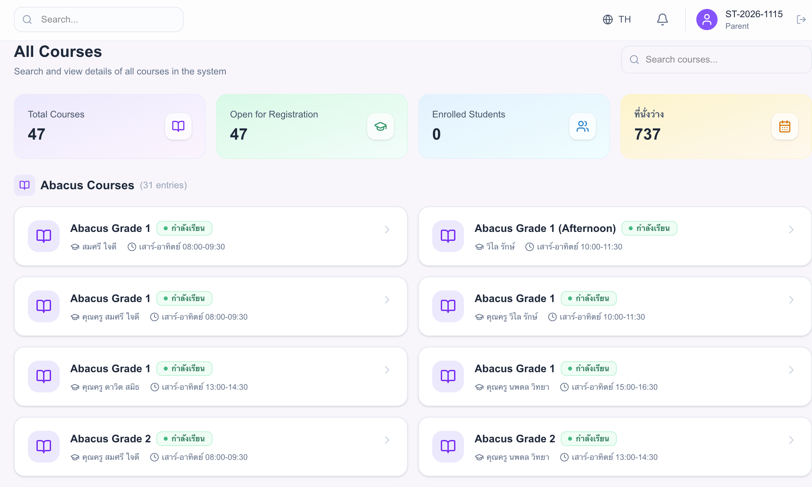
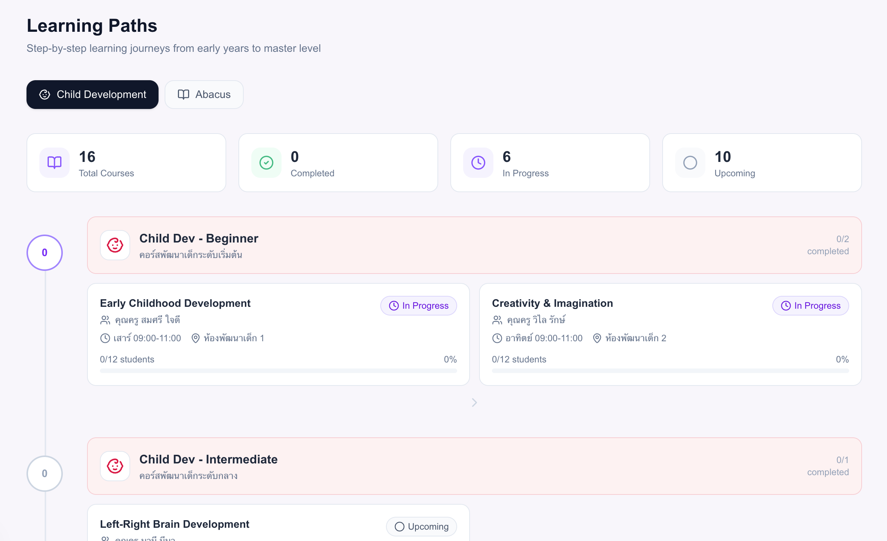
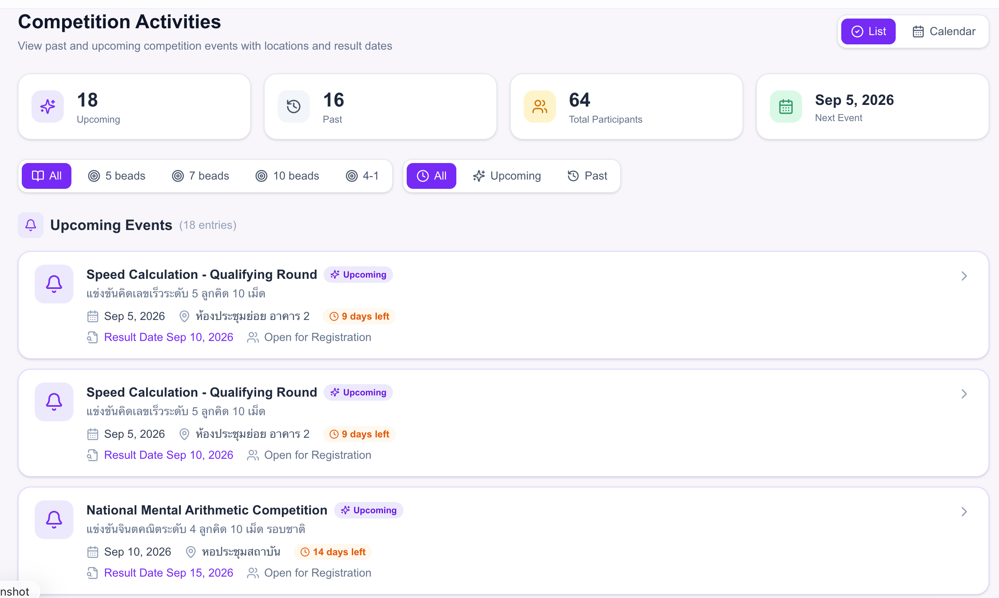
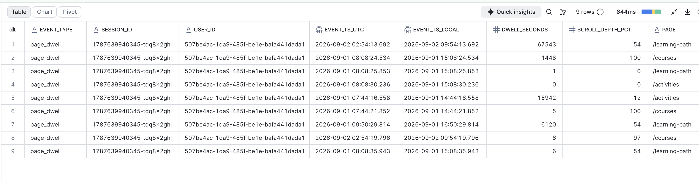
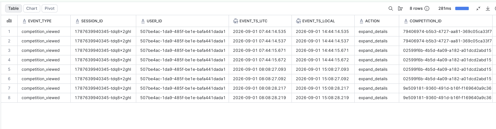
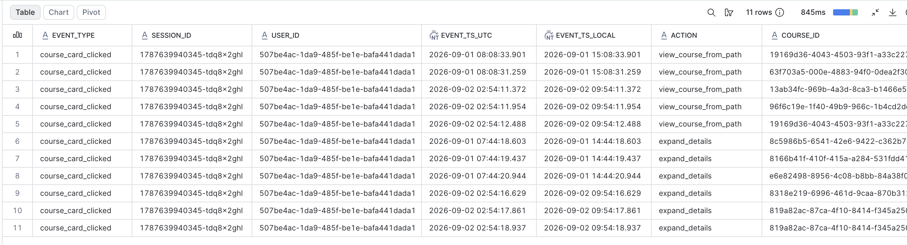

# Course Recommendation Pipeline — Kafka → Snowflake → dbt

Clickstream events from an education web app are streamed through **Kafka** into
**Snowflake** with the **Snowflake Connector for Kafka v4** (Snowpipe Streaming), then
transformed by **dbt** into a daily table of personalised course recommendations.
Everything around it is production-style: separate dev and prod databases, CI on
every pull request, scheduled deploys with GitHub Actions, run-level monitoring, a
recommendation hit-rate metric, and a repeatable **benchmark** from 1K to 1M events.

```
web app / generator ──► Kafka topic clickstream.events ──► Kafka Connect (Snowflake sink v4)
                                                                  │  Snowpipe Streaming
                                                                  ▼
                                   ABACUS_ANALYTICS.RAW.CLICKSTREAM_EVENTS   append-only JSON
                                                                  │  dbt
                                   STAGING.STG_*        typed views, one per event type
                                   INTERMEDIATE.INT_*   interactions, catalog, popularity,
                                                        affinity (time-decayed), co-occurrence
                                   MARTS                course_recommendations  ← the app reads this
                                                        course_recommendations_history, reco_run_metrics,
                                                        reco_hit_rate_daily     ← monitoring
```

**Ingestion is configuration.** The connector writes what the producer sent, and
`RAW` is never edited. A producer-side schema change never means rewriting landed
data.

**Transformation is code.** Every view and table downstream of `RAW` is a dbt model
in this repo, with dependencies declared through `source()` and `ref()` so dbt
resolves build order itself.

**Three flows, three purposes.**

| Flow | Trigger | Reads | Writes | Kept? |
|---|---|---|---|---|
| **Production** (`dbt deploy`) | merge to `main`, daily 01:07 Bangkok | real `RAW.CLICKSTREAM_EVENTS` | `ABACUS_ANALYTICS` STAGING / INTERMEDIATE / MARTS | yes, the app reads it |
| **CI** (`dbt CI`) | every pull request | real `RAW.CLICKSTREAM_EVENTS` | `ABACUS_DEV.PR_<n>_*` | no, dropped after the run |
| **Benchmark** (`dbt benchmark`) | manual | fake `RAW.CLICKSTREAM_EVENTS_BENCH` | `ABACUS_DEV.PR_BENCH_<n>_*` | no, only timings are kept |

| Layer | Schema | Materialization | Owner |
|---|---|---|---|
| Landing | `RAW` | table, append-only | Kafka connector |
| Postgres sync (planned) | `RAW_APP` | table | external sync, typed at source |
| Staging | `STAGING` | view | dbt |
| Intermediate | `INTERMEDIATE` | table | dbt |
| Marts | `MARTS` | table (+ incremental history/metrics) | dbt |
| Seeds | `SEEDS` | table from CSV | dbt |

## The source application

Events come from an education platform for abacus (mental arithmetic) and early
child-development programs, running locally at `http://localhost:3000`. Parents and
students use it to browse and register for courses, track learning progress, and
find skills competitions.

Every interaction emits a JSON event to the `clickstream.events` topic, so clicking
through the UI exercises the whole pipeline. For volume, `scripts/generate_clickstream.py`
produces events with exactly the same shape from the app's real course and competition
data (ids prefixed `synth-` or `bench-`, so they are easy to find and remove).

**All course**



**Learning Path**



**Competition Activities**



Clicking a competition here produces a `competition_viewed` event; scrolling and
staying on the page produces `page_dwell` and `course_card_clicked`.

---

## Contents

- [Prerequisites](#prerequisites)
- [Phase 1 — Snowflake: the destination](#phase-1--snowflake-the-destination)
- [Phase 2 — Keys: the identity](#phase-2--keys-the-identity)
- [Phase 3 — The connector](#phase-3--the-connector)
- [Phase 4 — Confirm](#phase-4--confirm)
- [Phase 5 — dbt: transformation as code](#phase-5--dbt-transformation-as-code)
- [Phase 6 — Environments and CI/CD](#phase-6--environments-and-cicd)
- [Phase 7 — Monitoring: run metrics and hit rate](#phase-7--monitoring-run-metrics-and-hit-rate)
- [Phase 8 — Benchmark](#phase-8--benchmark)
- [Security and key rotation](#security-and-key-rotation)
- [Operating the connector](#operating-the-connector)
- [Running dbt](#running-dbt)
- [Troubleshooting — connector](#troubleshooting--connector)
- [Troubleshooting — dbt and CI](#troubleshooting--dbt-and-ci)
- [Repository layout](#repository-layout)
- [Status](#status)

---

## Prerequisites

| Requirement | Notes |
|---|---|
| Kafka broker reachable from the Connect worker | Internal listener `kafka:9092`, host `localhost:29092` |
| Docker with Compose | Kafka, Redpanda Console and Connect all run here |
| `openssl`, `jq`, `curl` | Standard on macOS |
| Python 3.10+ with dbt | dbt Fusion 2.0 locally; dbt-core 1.10 + dbt-snowflake in GitHub Actions |
| Python packages for the scripts | `confluent-kafka` (generator), `snowflake-connector-python` + `cryptography` (`bench_ingest.py`) |
| GitHub repository with Actions | Secrets: `SNOWFLAKE_ACCOUNT`, `SNOWFLAKE_DBT_USER`, `SNOWFLAKE_DBT_PRIVATE_KEY` |

---

## Phase 1 — Snowflake: the destination

### 1. Database and schemas

```sql
USE ROLE ACCOUNTADMIN;

CREATE DATABASE IF NOT EXISTS ABACUS_ANALYTICS;
CREATE SCHEMA   IF NOT EXISTS ABACUS_ANALYTICS.RAW;           -- append-only JSON landing
CREATE SCHEMA   IF NOT EXISTS ABACUS_ANALYTICS.RAW_APP;       -- Postgres sync, typed at source
CREATE SCHEMA   IF NOT EXISTS ABACUS_ANALYTICS.STAGING;       -- dbt: typed views over RAW
CREATE SCHEMA   IF NOT EXISTS ABACUS_ANALYTICS.INTERMEDIATE;  -- dbt: conformed events, features
CREATE SCHEMA   IF NOT EXISTS ABACUS_ANALYTICS.MARTS;         -- dbt: recommendations
```

A Personal Database (`USER$<name>`) will **not** work as a target — privileges on
its objects cannot be granted to account roles, `CREATE` least of all.

### 2. Role and service user

```sql
CREATE ROLE IF NOT EXISTS KAFKA_INGEST_ROLE;

CREATE USER IF NOT EXISTS KAFKA_INGEST_SVC
    TYPE         = SERVICE
    DEFAULT_ROLE = KAFKA_INGEST_ROLE;
```

`TYPE = SERVICE` cannot hold a password and cannot enrol in MFA, so key-pair auth is
the only way in. That is all connector v4 supports, and what Snowflake now requires
for non-human users.

**Gate** — `SHOW USERS LIKE 'KAFKA_INGEST_SVC';` must return one row.

---

## Phase 2 — Keys: the identity

There are **two** identities for ingestion and local dbt (a third, `DBT_CI_SVC` for GitHub Actions, is added in Phase 6), each with its own key pair. Do not
share one key between them: rotating it would break both systems, and it blurs which
system performed which action in the audit trail.

| Identity | Type | Key | Used by |
|---|---|---|---|
| `KAFKA_INGEST_SVC` | `SERVICE` | `connectors/secrets/sf_key.p8` | Kafka connector, writes `RAW` |

Phase 2 covers the connector's key. The dbt key is in
[Phase 5](#phase-5--dbt-transformation-as-code).

### 3. Generate the key pair

Find the host folder mounted into the container first, so the files land where the
connector can read them:

```bash
docker inspect connect \
  --format '{{range .Mounts}}{{.Source}} -> {{.Destination}}{{"\n"}}{{end}}'
```

Then, inside the path that maps to `/opt/kafka/secrets`:

```bash
openssl genrsa 2048 | openssl pkcs8 -topk8 -inform PEM -nocrypt -out sf_key.p8
openssl rsa -in sf_key.p8 -pubout -out sf_key.pub
```

**Gate** — the one that cost the most time.

```bash
head -1 sf_key.pub    # must print: -----BEGIN PUBLIC KEY-----
```

If it says `PRIVATE` or `ENCRYPTED`, stop and regenerate. Every later step fails in a
way that never mentions keys.

Two files, two destinations:

| File | Half | Goes to |
|---|---|---|
| `sf_key.p8` | private | stays on this machine, read by the connector |
| `sf_key.pub` | public | registered in Snowflake |

Quick identification: a 2048-bit **public** key body starts
`MIIBIjANBgkqhkiG9w0BAQEFAAOCAQ8A` and runs ~392 chars. A **private** key starts
`MIIEv` / `MIIEp` / `MIIFD` and runs 1200+.

### 4. Private half → the secrets file

```bash
printf 'private_key=%s\n' "$(grep -v '^-----' sf_key.p8 | tr -d '\n')" \
  > snowflake.properties
chmod 600 snowflake.properties
```

**Gate**

```bash
wc -c snowflake.properties    # ~1637 bytes. ~13 means it is EMPTY.
wc -l snowflake.properties    # must be 1 — a newline breaks the parser
```

Do not use a heredoc here. If the `$(grep …)` substitution fails, a heredoc writes
the file anyway with an empty value and says nothing.

### 5. Public half → Snowflake

Generate the whole statement so there is nothing to hand-edit:

```bash
echo "ALTER USER KAFKA_INGEST_SVC SET RSA_PUBLIC_KEY = '$(grep -v '^-----' sf_key.pub | tr -d '\n')';" | pbcopy
```

Paste into Snowsight and run.

**Gate** — `DESC USER KAFKA_INGEST_SVC;` → `RSA_PUBLIC_KEY_FP` must show `SHA256:…`.
Blank means it did not register.

### 6. Grants

```sql
GRANT USAGE        ON DATABASE ABACUS_ANALYTICS     TO ROLE KAFKA_INGEST_ROLE;
GRANT USAGE        ON SCHEMA   ABACUS_ANALYTICS.RAW TO ROLE KAFKA_INGEST_ROLE;
GRANT CREATE TABLE ON SCHEMA   ABACUS_ANALYTICS.RAW TO ROLE KAFKA_INGEST_ROLE;

GRANT ROLE KAFKA_INGEST_ROLE TO USER KAFKA_INGEST_SVC;
```

`CREATE TABLE` because the connector creates its own target — and owns what it
creates, so `INSERT` comes along automatically. No warehouse grant: Snowpipe
Streaming ingestion is serverless.

So you can read the data yourself afterwards:

```sql
GRANT ROLE KAFKA_INGEST_ROLE TO ROLE SYSADMIN;
GRANT SELECT ON FUTURE TABLES IN SCHEMA ABACUS_ANALYTICS.RAW TO ROLE SYSADMIN;
```

Without this, even `ACCOUNTADMIN` gets `Insufficient privileges` on the
connector-created table — it is owned by a role outside that hierarchy.
`FUTURE TABLES` covers every topic you add later.

**Gate** — `SHOW GRANTS TO ROLE KAFKA_INGEST_ROLE;` → four rows.

---

## Phase 3 — The connector

### 7. Connector config

`connectors/snowflake-sink-v4.json`

```json
{
  "name": "clickstream-snowflake-sink",
  "config": {
    "connector.class": "com.snowflake.kafka.connector.SnowflakeStreamingSinkConnector",
    "tasks.max": "4",

    "topics": "clickstream.events,clickstream.bench",
    "snowflake.topic2table.map": "clickstream.events:CLICKSTREAM_EVENTS,clickstream.bench:CLICKSTREAM_EVENTS_BENCH",

    "snowflake.url.name": "https://<ORG>-<ACCOUNT>.snowflakecomputing.com",
    "snowflake.user.name": "KAFKA_INGEST_SVC",
    "snowflake.role.name": "KAFKA_INGEST_ROLE",
    "snowflake.database.name": "ABACUS_ANALYTICS",
    "snowflake.schema.name": "RAW",

    "snowflake.private.key": "${file:/opt/kafka/secrets/snowflake.properties:private_key}",

    "key.converter": "org.apache.kafka.connect.storage.StringConverter",
    "value.converter": "org.apache.kafka.connect.json.JsonConverter",
    "value.converter.schemas.enable": "false",

    "snowflake.enable.schematization": "true",
    "snowflake.streaming.validate.compatibility.with.classic": "false",

    "errors.tolerance": "all",
    "errors.log.enable": "true",
    "errors.deadletterqueue.topic.name": "clickstream.events.dlq",
    "errors.deadletterqueue.topic.replication.factor": "1"
  }
}
```

Every value must match Phase 1 exactly. That string matching, plus the key pair, is
the entire link between Kafka and Snowflake.

The second topic, `clickstream.bench`, feeds the benchmark table
`CLICKSTREAM_EVENTS_BENCH` and nothing else (see [Phase 8](#phase-8--benchmark)).

If the private key is pasted **inline** instead of the `${file:…}` reference above,
the real JSON becomes a secret: gitignore it and commit
`connectors/snowflake-sink-v4.example.json` with a `<PUT_KEY_HERE>` placeholder.

Three settings that are easy to get wrong:

- `snowflake.private.key` must use the **container** path `/opt/kafka/secrets/…`. A
  host path (`/Users/…`) fails with `Could not read properties from file` — the
  connector resolves it inside the container, where that path does not exist.
- `snowflake.streaming.validate.compatibility.with.classic: "false"` is required for
  a fresh install. v4 defaults it to `true`, which then demands four v3-migration
  settings and blocks startup. It exists to protect people migrating from connector
  v3; there is nothing to protect here.
- `…deadletterqueue.topic.replication.factor: "1"` on a single broker. With `3`, the
  first malformed message crashes the error handler itself.

Omit `snowflake.private.key.passphrase` entirely — the key above is `-nocrypt`.
Pointing it at a nonexistent properties entry resolves to empty and fails during
decryption.

### 8. Start the Connect worker

```bash
cd docker
docker compose -f docker-compose.yml -f docker-compose.connect.yml up -d
docker compose -f docker-compose.yml -f docker-compose.connect.yml logs -f connect
```

Pass both files so Connect joins the same Compose project as Kafka and can resolve
`kafka:9092`. A standalone run creates its own network, and the worker dies with
`No resolvable bootstrap urls given in bootstrap.servers`.

First start downloads the connector — allow two or three minutes. Port 8083 is
published immediately but accepts nothing until the JVM binds it.

**Gate** — three checks

```bash
docker exec connect ls -l /opt/kafka/secrets     # lists snowflake.properties
docker exec connect nc -zv kafka 9092            # network join works
curl -s localhost:8083/connector-plugins | jq -r '.[].class' | grep -i snowflake
```

An empty first result means the volume path is wrong. Docker creates an empty
directory rather than failing.

### 9. Deploy

```bash
curl -s -X POST -H "Content-Type: application/json" \
  --data @connectors/snowflake-sink-v4.json \
  localhost:8083/connectors | jq
```

Never use `curl -f` against the Connect API. It discards the response body on a
4xx/5xx — which is exactly where the error message lives.

```bash
curl -s localhost:8083/connectors/clickstream-snowflake-sink/status | jq
```

**Gate** — `state: RUNNING` for the connector and all four tasks.

Read the whole status object. `.connector.trace` and `.tasks[].trace` are different
failures, and a connector that fails during startup never creates tasks — so the task
array is empty and the only explanation is on the connector.

---

## Phase 4 — Confirm

### 10. Data is landing

```sql
SELECT TABLE_SCHEMA, TABLE_NAME, ROW_COUNT, CREATED
FROM ABACUS_ANALYTICS.INFORMATION_SCHEMA.TABLES
ORDER BY CREATED DESC;

SELECT * FROM ABACUS_ANALYTICS.RAW.CLICKSTREAM_EVENTS LIMIT 5;
DESC TABLE ABACUS_ANALYTICS.RAW.CLICKSTREAM_EVENTS;
```

With schematization on, each top-level JSON key becomes a column:

| Column | Type | Notes |
|---|---|---|
| `EVENT_TYPE`, `USER_ID`, `SESSION_ID`, `PAGE_URL` | `VARCHAR` | already typed |
| `TIMESTAMP` | `TIMESTAMP_NTZ` | already parsed — do not wrap in `TRY_TO_TIMESTAMP_TZ` |
| `METADATA` | `OBJECT` | nested fields, reached with `:` |
| `RECORD_METADATA` | `VARIANT` | Kafka topic / partition / offset |

This is the contract dbt builds on. `RAW` stays exactly what Kafka sent; all shaping
happens from here on, in dbt.

---

## Phase 5 — dbt: transformation as code

The typed views in `STAGING` were originally created by hand with
`CREATE OR REPLACE VIEW`, run statement by statement in Snowsight. They are now dbt
models: each file contains only a `SELECT`, and dbt generates the
`create or replace view` wrapper at run time. The declarative parts — which database
and schema `RAW` lives in, and whether a layer materializes as view or table — move
out of the SQL into configuration.

| Was | Now |
|---|---|
| `CREATE OR REPLACE VIEW STAGING.PAGE_DWELL AS …` | `models/staging/stg_page_dwell.sql` |
| `FROM ABACUS_ANALYTICS.RAW.CLICKSTREAM_EVENTS` | `{{ source('raw', 'clickstream_events') }}` |
| `CREATE OR REPLACE VIEW` in each script | `+materialized: view` on the folder |
| Run by hand in a worksheet | `dbt run --select staging` |
| `sql/02_view_page_dwell.sql`, `sql/03_…` | `dbt_clickstream/models/staging/` |

What this buys over the hand-run scripts:

- **Lineage.** `source()` and `ref()` make the dependency graph explicit, so dbt
  builds staging → intermediate → marts in order without being told.
- **Tests as code.** `not_null` on `competition_id`, uniqueness on
  `(kafka_partition, kafka_offset)`, freshness on the landing table — `dbt test`
  instead of someone's memory.
- **One place for environment differences.** Dev and prod point at different schemas
  through the profile target; the model SQL is identical.
- **Version control and review.** A change to the flattening logic is a diff, not a
  worksheet someone re-ran.

### 11. dbt's identity: key-pair auth

dbt on the laptop connects as your human user, not as `KAFKA_INGEST_SVC`. Two facts about
this account force key-pair auth:

- Browser SSO fails with `390190` — a deprecated `SAML_IDENTITY_PROVIDER` account
  parameter, fixable only account-side.
- Password auth requires MFA/TOTP, which no multi-threaded tool can satisfy: dbt
  opens one connection per thread.

Key-pair authentication is exempt from both.

```bash
mkdir -p ~/.snowflake
openssl genrsa 2048 | openssl pkcs8 -topk8 -inform PEM \
  -out ~/.snowflake/dbt_rsa_key.p8 -nocrypt
openssl rsa -in ~/.snowflake/dbt_rsa_key.p8 -pubout \
  -out ~/.snowflake/dbt_rsa_key.pub
chmod 600 ~/.snowflake/dbt_rsa_key.p8

# single-line public key body for the ALTER USER below
grep -v "^-" ~/.snowflake/dbt_rsa_key.pub | tr -d '\n'
```

```bash
openssl rsa -in ~/.snowflake/dbt_rsa_key.p8 -pubout -outform DER 2>/dev/null \
  | openssl dgst -sha256 -binary | openssl enc -base64
# prefix with SHA256: and compare to RSA_PUBLIC_KEY_FP
```

Do **not** reuse `connectors/secrets/sf_key.p8`. That key is registered to
`KAFKA_INGEST_SVC`; Snowflake builds the JWT subject from `ACCOUNT.USER`, so signing
with it as your user fails with exactly the error above.

### 12. Role and grants for dbt

```sql
USE ROLE ACCOUNTADMIN;

CREATE ROLE IF NOT EXISTS DBT_ROLE;
GRANT ROLE DBT_ROLE TO USER "<your_user_name>";   -- exact NAME from SHOW USERS, quoted
GRANT ROLE DBT_ROLE TO ROLE SYSADMIN;

GRANT USAGE ON WAREHOUSE ABACUS_WH       TO ROLE DBT_ROLE;
GRANT USAGE ON DATABASE  ABACUS_ANALYTICS TO ROLE DBT_ROLE;

-- read the landing zone
GRANT USAGE  ON SCHEMA        ABACUS_ANALYTICS.RAW TO ROLE DBT_ROLE;
GRANT SELECT ON ALL TABLES    IN SCHEMA ABACUS_ANALYTICS.RAW TO ROLE DBT_ROLE;
GRANT SELECT ON FUTURE TABLES IN SCHEMA ABACUS_ANALYTICS.RAW TO ROLE DBT_ROLE;

-- write the transformed layers
GRANT ALL PRIVILEGES ON SCHEMA ABACUS_ANALYTICS.STAGING      TO ROLE DBT_ROLE;
GRANT ALL PRIVILEGES ON SCHEMA ABACUS_ANALYTICS.INTERMEDIATE TO ROLE DBT_ROLE;
GRANT ALL PRIVILEGES ON SCHEMA ABACUS_ANALYTICS.MARTS        TO ROLE DBT_ROLE;
GRANT CREATE SCHEMA  ON DATABASE ABACUS_ANALYTICS            TO ROLE DBT_ROLE;
```

Unlike the connector, dbt **does** need a warehouse — it runs SQL, which Snowpipe
Streaming ingestion does not.

**Gate**

```sql
USE ROLE DBT_ROLE;
SELECT COUNT(*) FROM ABACUS_ANALYTICS.RAW.CLICKSTREAM_EVENTS;
```

### 13. Project and profile

`dbt_clickstream/dbt_project.yml`

```yaml
name: abacus_analytics
version: "1.0.0"
profile: abacus
model-paths: ["models"]
macro-paths: ["macros"]
seed-paths: ["seeds"]

vars:
  affinity_lookback_days: 90
  affinity_half_life_days: 14      # a click 14 days old counts half
  popularity_lookback_days: 30
  min_co_actors: 2
  recommendations_per_actor: 5
  # … dwell_* and attribution_* reserved for the dwell model

models:
  abacus_analytics:
    +query_tag: "dbt_abacus_{{ target.name }}_{{ env_var('GITHUB_RUN_ID', 'local') }}"
    staging:
      +schema: staging
      +materialized: view
    intermediate:
      +schema: intermediate
      +materialized: table
    marts:
      +schema: marts
      +materialized: table

seeds:
  abacus_analytics:
    +schema: seeds
```

Config keys under `models:` map to **directory names** under `model-paths`. A key
matching no directory produces an `UnusedResourceConfigPath` warning — keep the
config tree and the folder tree in sync.

`~/.dbt/profiles.yml`

```yaml
abacus:
  target: dev
  outputs:
    dev:
      type: snowflake
      account: <ORG>-<ACCOUNT>
      user: <LOGIN_NAME>                                   # LOGIN_NAME from SHOW USERS
      private_key_path: /Users/<you>/.snowflake/dbt_rsa_key.p8   # absolute path: dbt Fusion does not expand ~
      role: DBT_ROLE
      database: ABACUS_DEV                                 # laptop builds never touch prod
      warehouse: ABACUS_WH
      schema: STAGING
      threads: 4
    prod:                                                  # manual emergency use only; GitHub deploys prod
      # same as dev, with database: ABACUS_ANALYTICS
```

Things that will waste an afternoon if wrong:

- `account` is `<org>-<account_name>` with no `.snowflakecomputing.com` suffix.
  Confirm with
  `SELECT CURRENT_ORGANIZATION_NAME() || '-' || CURRENT_ACCOUNT_NAME();`
- `user` is the `LOGIN_NAME` from `DESC USER` — not the account name, not necessarily
  the email.
- Do **not** also set `password` or `authenticator`. Either one makes dbt warn that
  the key-pair credential is being ignored, and the connection follows the wrong auth
  path.
- dbt only reads a file named exactly `profiles.yml`. `dbt_projects_profiles.yml` in
  the project directory is the Snowflake-native dbt Projects artifact and is ignored
  by dbt Core. Every `dbt debug` prints which file it loaded — read that line.
- A user's `NAME` and `LOGIN_NAME` can differ. A sign-up user may be named
  `banaspih` (lowercase, created quoted) with login `you@gmail.com`: SQL needs
  `ALTER USER "banaspih"`, while the profile's `user:` takes the login name.
- `warehouse` must name a warehouse that exists **and** that `DBT_ROLE` has `USAGE` on;
  otherwise views build but every table, seed and test fails with
  `No active warehouse selected`.

dbt's default schema name is `target.schema` and the custom schema **concatenated**
(`STAGING_staging`). This project overrides `generate_schema_name` so `+schema: marts`
lands in `MARTS`, and only the `ci` target adds a `PR_<n>_` prefix (Phase 6).

### 14. Sources

`dbt_clickstream/models/staging/_sources.yml` is what makes `source()` resolve. Without it, any
model referencing the landing table fails at parse time with `DependencyNotFound`.

```yaml
version: 2

sources:
  - name: raw
    database: ABACUS_ANALYTICS          # pinned: dev and CI read prod RAW
    schema: RAW
    tables:
      - name: clickstream_events
        identifier: "{{ var('raw_events_table', 'CLICKSTREAM_EVENTS') }}"
        config:
          loaded_at_field: "to_timestamp_ltz(record_metadata:CreateTime::number, 3)"
          freshness:
            warn_after:  {count: 6,  period: hour}
            error_after: {count: 24, period: hour}
```

The two arguments to `source('raw', 'clickstream_events')` match the `name:` keys
only — they are independent of the actual schema name. The fact that the source is
*called* `raw` and its schema is *also* `RAW` is convention, not requirement.

**Gate** — `dbt ls --resource-type source` must print
`abacus_analytics.raw.clickstream_events`.

### 15. Staging models

> In this project, course-click deduplication currently happens in
> `int_course_interactions`; a shared base model, as described below, is a planned refactor.

One model per event type. Rename, cast, flatten `METADATA` — nothing else. No joins,
no aggregation, no business logic.

Materialized as **views**: staging is a rename layer over data that already exists in
`RAW`, Kafka streams into it continuously, and a view is always current without
storing a second copy.

**Deduplicate once**, in a base model, not in each typed model. Kafka is
at-least-once and a connector restart re-delivers messages.
`(RECORD_METADATA:partition, RECORD_METADATA:offset)` is unique and stable, so it is
both the dedupe key and the way to trace a row back to the topic.

```sql
-- models/staging/base_clickstream_events.sql
{{ config(materialized='view') }}

select *
from {{ source('raw', 'clickstream_events') }}
qualify row_number() over (
    partition by record_metadata:partition::int,
                 record_metadata:offset::bigint
    order by 1
) = 1
```

Every typed model then reads `{{ ref('base_clickstream_events') }}` and filters by
`event_type`. In the hand-written views this dedupe existed only in `PAGE_DWELL`, so
`COMPETITION_VIEWED` and `COURSE_CARD_CLICKED` double-counted on restart. One base
model fixes all three at once — the kind of thing that is awkward with maintained DDL
and natural with `ref()`.

```sql
-- models/staging/stg_page_dwell.sql

select
    event_type,
    session_id,
    user_id,
    "TIMESTAMP"::timestamp_ntz                          as event_ts_utc,
    convert_timezone('UTC', 'Asia/Bangkok',
        "TIMESTAMP"::timestamp_ntz)                     as event_ts_local,
    metadata:dwell_seconds::int                         as dwell_seconds_raw,
    least(metadata:dwell_seconds::int, 300)             as dwell_seconds_capped,
    metadata:scroll_depth_pct::int                      as scroll_depth_pct,
    metadata:page::string                               as page,
    metadata:referer::string                            as referer,
    metadata:ip::string                                 as ip,
    metadata:user_agent::string                         as user_agent,
    record_metadata:partition::int                      as kafka_partition,
    record_metadata:offset::bigint                      as kafka_offset
from {{ ref('base_clickstream_events') }}
where event_type = 'page_dwell'
```



```sql
-- models/staging/stg_competition_viewed.sql

select
    event_type,
    session_id,
    user_id,
    "TIMESTAMP"::timestamp_ntz                          as event_ts_utc,
    convert_timezone('UTC', 'Asia/Bangkok',
        "TIMESTAMP"::timestamp_ntz)                     as event_ts_local,
    metadata:action::string                             as action,
    metadata:competition_id::string                     as competition_id,
    metadata:competition_name::string                   as competition_name,
    metadata:competition_name_en::string                as competition_name_en,
    metadata:grade::string                              as grade,
    metadata:program::string                            as program,
    metadata:language::string                           as language,
    metadata:source::string                             as source,
    metadata:referer::string                            as referer,
    metadata:ip::string                                 as ip,
    metadata:user_agent::string                         as user_agent,
    record_metadata:partition::int                      as kafka_partition,
    record_metadata:offset::bigint                      as kafka_offset
from {{ ref('base_clickstream_events') }}
where event_type = 'competition_viewed'
```



```sql
-- models/staging/stg_course_card_clicked.sql

select
    event_type,
    session_id,
    user_id,
    "TIMESTAMP"::timestamp_ntz                          as event_ts_utc,
    convert_timezone('UTC', 'Asia/Bangkok',
        "TIMESTAMP"::timestamp_ntz)                     as event_ts_local,
    metadata:action::string                             as action,
    metadata:course_id::string                          as course_id,
    metadata:course_name::string                        as course_name,
    metadata:course_name_en::string                     as course_name_en,
    metadata:path_type::string                          as path_type,
    metadata:language::string                           as language,
    metadata:source::string                             as source,
    metadata:referer::string                            as referer,
    metadata:ip::string                                 as ip,
    metadata:user_agent::string                         as user_agent,
    record_metadata:partition::int                      as kafka_partition,
    record_metadata:offset::bigint                      as kafka_offset
from {{ ref('base_clickstream_events') }}
where event_type = 'course_card_clicked'
```



**Casting rules for this data**

- `:` walks into JSON, `::` casts out of VARIANT. `METADATA:dwell_seconds::INT`.
  `METADATA::dwell_seconds` means "cast to a type named `DWELL_SECONDS`" and errors.
- `ip` is always `::STRING` — values include `::1` (IPv6 loopback).
- Comparisons use `=` and single quotes: `event_type = 'page_dwell'`. Double quotes
  mean an identifier; `==` is not SQL.
- Every `:` path needs a `::type`. Without it you get a VARIANT, and
  `METADATA:page = '/activities'` will not match because the JSON string keeps its
  quotes.
- `"TIMESTAMP"` is quoted because `timestamp` is a Snowflake reserved word. It is
  already `TIMESTAMP_NTZ`; the explicit `::timestamp_ntz` is defensive, so
  `CONVERT_TIMEZONE`'s three-argument form is guaranteed a real timestamp.
- Each alias in a view's final `SELECT` must be unique. Snowflake upper-cases
  unquoted identifiers, so extracting `competition_id` twice — once from `METADATA`,
  once from a URL parse — fails with `duplicate column name 'COMPETITION_ID'`.

**Data quality note.** Observed rows include `dwell_seconds: 1448` with
`scroll_depth_pct: 100` — a tab left open, not engagement. The model above keeps both
`dwell_seconds_raw` and `dwell_seconds_capped`; everything downstream uses the capped
column.

**Gate**

```sql
SELECT page, COUNT(*) AS events, AVG(dwell_seconds_capped) AS avg_dwell
FROM ABACUS_ANALYTICS.STAGING.STG_PAGE_DWELL
GROUP BY page ORDER BY events DESC;
```

**Migration note.** dbt's models are named after their files, so
`STAGING.STG_PAGE_DWELL` is a different object from the hand-made
`STAGING.PAGE_DWELL` — nothing is overwritten. Once the dbt models are verified,
drop the originals so two definitions cannot drift apart. Save them first if you want
the history:

```sql
SELECT GET_DDL('VIEW', 'ABACUS_ANALYTICS.STAGING.PAGE_DWELL');
DROP VIEW ABACUS_ANALYTICS.STAGING.PAGE_DWELL;
DROP VIEW ABACUS_ANALYTICS.STAGING.COMPETITION_VIEWED;
DROP VIEW ABACUS_ANALYTICS.STAGING.COURSE_CARD_CLICKED;
```

To keep the original names instead, add `{{ config(alias='page_dwell') }}` to the
model and let dbt take ownership of that object.

### 16. Intermediate layer

Staging says *what happened*. Intermediate says *what does this parent like, and which
courses go together*. Marts say *what to show parent X*.

Rules for this layer:

1. **Never use `source()`**, only `ref()`. If a raw column is missing, add it to
   staging.
2. **Declare the grain** of every model. Every bug in this layer is a grain bug: a
   join that fanned out and silently doubled the counts. Tests make the grain
   executable (`unique`, `dbt_utils.unique_combination_of_columns`).
3. **Materialize as tables.** This layer does real work; compute once per run.
4. **Nothing outside dbt reads this layer.** Marts are the contract.

Two identities in one column. `user_id` is null for anonymous visitors, so every model
uses `actor_id = coalesce(user_id, 'anon' || session_id)`. Session-scoped identity is
weaker than a real user id, but it is most of the signal.

One course, many offerings. The app has one `course_id` per time slot
(`Abacus Grade 3 (Sat 10:00)`, `(Sun 14:00)`, …). The `course_key` macro normalises
the name so all slots of a course share one key:

```sql
-- macros/course_key.sql
lower(trim(regexp_replace(<name>, '\\s*\\(.*\\)\\s*$', '')))   -- 'Abacus Grade 3 (Sat 10:00)' → 'abacus grade 3'
```

| Model | Grain | What it does |
|---|---|---|
| `int_course_interactions` | one course click (exact duplicates removed) | `actor_id`, `course_key`, `offering_id`; dedupes Kafka re-deliveries with `qualify row_number()`; `interaction_id` surrogate key; joins the seed `course_action_weights` (unknown actions default to 0.5) |
| `int_course_catalog` | one `course_key` | latest English/Thai name (`max_by(…, event_ts_utc)`), `program`, `grade`, `offering_count` |
| `int_course_popularity` | one `course_key` | distinct parents and weighted clicks in the last `popularity_lookback_days` (30); `rank()` → `popularity_rank` |
| `int_actor_course_affinity` | one `actor_id` + `course_key` | `affinity_score = sum(action_weight × decay)` over the last `affinity_lookback_days` (90) |
| `int_course_coocurrence` | one `course_key` + `other_course_key` | self-join on the same parent; keep pairs with at least `min_co_actors` (2) parents |

**Time decay.** A click loses half its weight every `affinity_half_life_days` (14):

```sql
power(0.5, datediff('hour', event_ts_utc, current_timestamp()) / 24.0 / {{ var('affinity_half_life_days') }}) as decay
```

| Age | 0 d | 7 d | 14 d | 28 d | 56 d |
|---|---|---|---|---|---|
| decay | 1.00 | 0.71 | 0.50 | 0.25 | 0.06 |

All tunables live in `dbt_project.yml` → `vars` and can be overridden per run, e.g.
`dbt build --vars '{affinity_half_life_days: 7}'`.

### 17. Marts

Business-facing, stable column names. The only layer an application, BI tool or
teammate should query.

**`course_recommendations`**: top `recommendations_per_actor` (5) courses per parent.

```
affinity ─┬─► similar  (priority 1): affinity_score × co_actor_count, via int_course_coocurrence
          └─► popular  (priority 2): 1 / popularity_rank, offered to every parent (cold-start fallback)
                   │ union all
                   ▼
             not_seen        drop courses the parent already clicked (left join … is null)
             one_per_course  same course from both sources → keep the better one (qualify row_number)
             ranked          row_number() over (partition by actor_id order by priority, score desc)
             final           join int_course_catalog for names/program; keep rank ≤ 5
```

`priority` is a constant chosen per source (1 = personal, 2 = popular), so personal
recommendations always outrank the popular fallback; `score` only orders rows within
the same source.

**Monitoring marts** (details in [Phase 7](#phase-7--monitoring-run-metrics-and-hit-rate)):

| Model | Materialization | Purpose |
|---|---|---|
| `course_recommendations_history` | incremental, `append`, `full_refresh=false` | a copy of every run's list |
| `reco_run_metrics` | incremental, `append`, `full_refresh=false` | one health row per run |
| `reco_hit_rate_daily` | table | did parents click yesterday's recommendations? |

**Incremental vs full rebuild.** Most models are full rebuilds on purpose: affinity
decay and the popularity window depend on *today's date*, so yesterday's numbers are
already wrong today. Only history-keeping models append.

| Type | Models |
|---|---|
| append-only | `RAW` (connector), `course_recommendations_history`, `reco_run_metrics` |
| full rebuild (must stay) | catalog, popularity, affinity, co-occurrence, recommendations, hit rate |
| full rebuild → incremental next | `int_course_interactions` (immutable events, biggest table) |
| view | staging |

No dbt **snapshot** is needed today: events never change after they land, and the
history table already keeps every recommendation list. A snapshot becomes useful when
a mutable table (e.g. Supabase `courses`: names, status) is loaded as a source.

**Tests** (31 in total) assert grain and integrity: `unique` / `not_null` on keys,
`unique_combination_of_columns` on `(actor_id, course_key)` and
`(course_key, other_course_key)`, `relationships` to `int_course_catalog`,
`expression_is_true: course_key <> other_course_key`, and `accepted_range` on
`hit_rate`. dbt Fusion requires generic-test parameters under `arguments:`.

---

## Phase 6 — Environments and CI/CD

### 18. Three environments

| Target | Who runs it | Database | Schemas | Profile |
|---|---|---|---|---|
| `dev` | you, on the laptop | `ABACUS_DEV` | `STAGING`, `INTERMEDIATE`, `MARTS`, `SEEDS` | `~/.dbt/profiles.yml` |
| `ci` | GitHub Actions (PRs, benchmark) | `ABACUS_DEV` | `PR_<n>_STAGING`, `PR_<n>_MARTS`, … | `dbt_clickstream/ci/profiles.yml` |
| `prod` | GitHub Actions (deploy) | `ABACUS_ANALYTICS` | `STAGING`, `INTERMEDIATE`, `MARTS`, `SEEDS` | `dbt_clickstream/ci/profiles.yml` |

All three read the same `ABACUS_ANALYTICS.RAW` (the source pins `database:`), but only
`prod` writes to `ABACUS_ANALYTICS`. A half-finished model on the laptop can never
reach the app.

```sql
USE ROLE SYSADMIN;
CREATE DATABASE IF NOT EXISTS ABACUS_DEV;
GRANT OWNERSHIP ON DATABASE ABACUS_DEV TO ROLE DBT_ROLE COPY CURRENT GRANTS;
GRANT USAGE, OPERATE ON WAREHOUSE ABACUS_WH TO ROLE DBT_ROLE;
```

### 19. Schema naming

`macros/generate_schema_name.sql` replaces dbt's default (`<target.schema>_<custom>`,
which produced `STAGING_staging`). `dev` and `prod` use the folder schema as-is; only
`ci` adds the PR prefix:

```sql

    
    
        {{ target.schema | trim | upper }}_{{ base }}      {#- PR_12 + MARTS → PR_12_MARTS -#}
    
        {{ base }}
    

```

`macros/drop_ci_schemas.sql` removes a PR's schemas after the run and refuses any
prefix that does not start with `PR_`, so it can never drop `STAGING` or `MARTS`:

```bash
dbt run-operation drop_ci_schemas --args "{prefix: PR_12}" --target ci
```

### 20. CI identity and GitHub secrets

GitHub logs in as a dedicated service user with its own key pair:

```sql
USE ROLE SECURITYADMIN;
CREATE USER IF NOT EXISTS DBT_CI_SVC
    TYPE = SERVICE DEFAULT_ROLE = DBT_ROLE DEFAULT_WAREHOUSE = ABACUS_WH
    RSA_PUBLIC_KEY = '<contents of ~/.snowflake/dbt_ci_key.pub, one line>';
GRANT ROLE DBT_ROLE TO USER DBT_CI_SVC;
```

| GitHub secret | Value |
|---|---|
| `SNOWFLAKE_ACCOUNT` | `<ORG>-<ACCOUNT>` (no `https://`, no domain) |
| `SNOWFLAKE_DBT_USER` | `DBT_CI_SVC` |
| `SNOWFLAKE_DBT_PRIVATE_KEY` | full contents of `~/.snowflake/dbt_ci_key.p8` (`pbcopy < ~/.snowflake/dbt_ci_key.p8`) |

`ci/profiles.yml` contains no secrets, only `env_var()` lookups, so it is committed:

```yaml
abacus:
  target: ci
  outputs:
    ci:
      type: snowflake
      account: "{{ env_var('SNOWFLAKE_ACCOUNT') }}"
      user: "{{ env_var('SNOWFLAKE_USER') }}"
      private_key: "{{ env_var('SNOWFLAKE_PRIVATE_KEY') }}"
      role: DBT_ROLE
      database: ABACUS_DEV
      warehouse: ABACUS_WH
      schema: "{{ env_var('DBT_SCHEMA', 'PR_LOCAL') }}"
      threads: 4
    prod:
      # same, with database: ABACUS_ANALYTICS and schema: STAGING
```

### 21. Workflows

| Workflow | Trigger | What it does |
|---|---|---|
| `.github/workflows/dbt-ci.yml` | pull request touching `dbt_clickstream/**`, manual | `dbt build --target ci` into `ABACUS_DEV.PR_<n>_*`, step summary, drop schemas (`if: always()`) |
| `.github/workflows/dbt-deploy.yml` | push to `main`, cron `7 18 * * *` (01:07 Bangkok), manual | `dbt source freshness` (warn only), `dbt build --target prod`, summary with the 10 slowest models, `run_results.json` artifact |
| `.github/workflows/dbt-benchmark.yml` | manual, with a label | `dbt build` ×N with `--full-refresh` on the bench table, median timings — see [Phase 8](#phase-8--benchmark) |

The CI run is a rehearsal: its tables are deleted and nothing is copied to prod. A
merge triggers a **fresh** prod build from `main`. Protect `main` (require a PR and the
`build` check) so a red CI blocks the merge.

Every query carries a tag, so Snowflake's query history separates the flows:

```yaml
+query_tag: "dbt_abacus_{{ target.name }}_{{ env_var('GITHUB_RUN_ID', 'local') }}"
```

`dbt_abacus_prod_41407393949` is deploy run 41407393949; `dbt_abacus_dev_local` is the
laptop.

**Test CI locally** before pushing (same env vars GitHub sets):

```bash
cd dbt_clickstream
export DBT_PROFILES_DIR=ci SNOWFLAKE_ACCOUNT=<ORG>-<ACCOUNT> SNOWFLAKE_USER=DBT_CI_SVC \
       SNOWFLAKE_PRIVATE_KEY="$(cat ~/.snowflake/dbt_ci_key.p8)" DBT_SCHEMA=PR_TEST
dbt build --target ci                          # log shows PR_TEST_STAGING, PR_TEST_MARTS, …
dbt run-operation drop_ci_schemas --args '{prefix: PR_TEST}' --target ci
unset DBT_PROFILES_DIR SNOWFLAKE_ACCOUNT SNOWFLAKE_USER SNOWFLAKE_PRIVATE_KEY DBT_SCHEMA
```

---

## Phase 7 — Monitoring: run metrics and hit rate

Tests check **rules** (no nulls, no duplicates). Some failures pass every rule: an
empty mart, a stopped connector, every parent getting the same five popular courses.
Two marts watch for those.

### 22. `reco_run_metrics`: one health row per run

| Column | Meaning | Healthy |
|---|---|---|
| `run_at` | dbt start time (`run_started_at`) | one row per run |
| `actors` | parents with recommendations | grows with traffic, never a sudden 0 |
| `avg_recs_per_actor` | rows ÷ parents | close to 5 |
| `pct_personal` | share of `similar_parents` rows | rises as data grows |
| `catalog_coverage` | distinct recommended courses ÷ catalog size | moderate; very low = everyone gets the same list |
| `data_lag_minutes` | minutes since the newest click | small; hours = ingestion stopped |

```sql
SELECT run_at, actors, avg_recs_per_actor, pct_personal, catalog_coverage, data_lag_minutes
FROM ABACUS_ANALYTICS.MARTS.RECO_RUN_METRICS
ORDER BY run_at DESC;
```
| RUN_AT | ACTORS | REC_ROWS | AVG_RECS_PER_ACTOR | PCT_PERSONAL | COURSES_RECOMMENDED | CATALOG_SIZE | CATALOG_COVERAGE | INTERACTIONS_TOTAL | NEWEST_CLICK_AT | DATA_LAG_MINUTES |
| :--- | ---: | ---: | ---: | ---: | ---: | ---: | ---: | ---: | ---: | ---: |
| 2026-11-08 07:17:35.743 Z | 136 | 680 | 5 | 1 | 20 | 20 | 1 | 992 | 31:33.9 | 526 |
| 2026-11-07 05:28:08.968 Z | 40 | 200 | 5 | 0.995 | 19 | 20 | 0.95 | 291 | 08:56.5 | 560 |
| 2026-11-07 06:24:54.701 Z | 40 | 200 | 5 | 0.995 | 19 | 20 | 0.95 | 291 | 08:56.5 | 617 |

### 23. `reco_hit_rate_daily`: are the recommendations useful?

"Of the parents we recommended to on day D, how many clicked one of their recommended
courses on day D+1?" It uses the last list of each day from
`course_recommendations_history`, so the value for day D appears after the deploy on
D+1.

```sql
SELECT * FROM ABACUS_ANALYTICS.MARTS.RECO_HIT_RATE_DAILY ORDER BY reco_date;
```

| RECO_DATE | ACTORS_WITH_RECS | ACTORS_WHO_CLICKED_A_REC | HIT_RATE |
| :--- | ---: | ---: | ---: |
| 2026-11-07 | 40 | 0 | 0 |

With generator data the hit rate is chance, because synthetic parents never look at
their recommendations. Treat it as a **pipeline validation** (inject a known
click-through on recommended courses and check the metric recovers it), not as a
quality claim, until real users drive it.

---

## Phase 8 — Benchmark

The benchmark answers **"how fast, and how big?"**: the same pipeline, the same dbt
models, at 1K → 10K → 100K → 1M events, measured the same way each time. Quality is
measured separately by the hit rate on real data.

### 24. Isolation: fake events never reach production

```
generate_clickstream.py --topic clickstream.bench
        │
        ▼
Kafka clickstream.bench ──► connector ──► RAW.CLICKSTREAM_EVENTS_BENCH      (bench_ingest.py times this)
                                                   │
                         dbt benchmark workflow ───┘  dbt build ×3 --full-refresh
                                                      → ABACUS_DEV.PR_BENCH_<n>_*  (timed, then dropped)
```

| Piece | How |
|---|---|
| Topic | `clickstream.bench`, 3 partitions, replication 1 (created in Redpanda Console or `kafka-topics.sh`) |
| Table | connector maps `clickstream.bench:CLICKSTREAM_EVENTS_BENCH` in `snowflake.topic2table.map`; created on first write |
| dbt switch | the source's `identifier: "{{ var('raw_events_table', 'CLICKSTREAM_EVENTS') }}"` defaults to the real table; benchmarks pass `--vars '{raw_events_table: CLICKSTREAM_EVENTS_BENCH}'` |
| Output | `ci` target → `ABACUS_DEV.PR_BENCH_<run>_*`, dropped after timing |

One-time setup:

```sql
GRANT SELECT ON FUTURE TABLES IN SCHEMA ABACUS_ANALYTICS.RAW TO ROLE DBT_ROLE;  -- bench table is created later
ALTER USER DBT_CI_SVC SET USE_CACHED_RESULT = FALSE;   -- honest timings; set back to TRUE afterwards
```

### 25. Tools

**`scripts/generate_clickstream.py`** produces events with the same shape as the app,
from the real course and competition exports in `course_data/`:

| Option | Meaning |
|---|---|
| `--events N` | exactly N events (benchmarks) |
| `--topic clickstream.bench` | send to the bench topic |
| `--tag bench` | id prefix (`bench-…` instead of `synth-…`) |
| `--parents`, `--days`, `--seed`, `--anonymous`, `--dry-run` | normal traffic simulation |

It prints the produce rate and saves the run (start time, count) for the next script.

**`scripts/bench_ingest.py`** polls Snowflake until every event has landed and prints
end-to-end time, lag after the last send, and ingest events/s. Each run is appended to
`bench_results/ingest_results.csv`. Connection defaults can be overridden with
`SNOWFLAKE_ACCOUNT`, `SNOWFLAKE_USER`, `SNOWFLAKE_PRIVATE_KEY_PATH`, `SNOWFLAKE_ROLE`,
`SNOWFLAKE_WAREHOUSE`.

**`.github/workflows/dbt-benchmark.yml`** runs `dbt build` N times (default 3) with
`--full-refresh` on the bench table and writes the median total time and the 10
slowest models to the run summary; raw `run_results.json` files are kept as artifacts
for 90 days.

### 26. Procedure (per size)

```sql
TRUNCATE TABLE ABACUS_ANALYTICS.RAW.CLICKSTREAM_EVENTS_BENCH;   -- clean start
```

```bash
caffeinate -i &                                   # sleep breaks the connector's sessions
python scripts/generate_clickstream.py --events 10000 --topic clickstream.bench --tag bench
python scripts/bench_ingest.py --label "10k baseline"
```

Then **Actions → dbt benchmark → Run workflow** (label `10k baseline`, runs `3`). Wait
for it to finish before truncating for the next size; dbt reads the bench table during
all runs. For 1M, pass `--timeout 3600` to `bench_ingest.py`.

### 27. Results

Environment: Kafka + Connect in Docker on a MacBook (Apple Silicon), connector v4 with
4 tasks, Snowflake XS warehouse.

| Events | Produce (events/s) | Ingest end-to-end (s) | Ingest (events/s) | dbt build, median (s) | Slowest model |
|---|---|---|---|---|---|
| 1,000 | 67,602 | 36.4 | 27 | | |
| 10,000 | 89,140 | 26.1 | 383 | | |
| 100,000 | | | | | |
| 1,000,000 | | | | | |

The 1K run includes first-write overhead (the connector creating the bench table and
opening its Snowpipe Streaming channels), which is why it is slower end-to-end than
10K. Ingest time is dominated by the connector's flush interval, not by volume, so
events/s rises with batch size until the connector or warehouse becomes the limit.

**Next:** run the 100K and 1M baselines, make `int_course_interactions` incremental
(`unique_key='interaction_id'`, `merge`, 6-hour late-event lookback, `cluster_by` on
the event date), and re-run 1M to record the before/after build time.

**Reliability checks to run with the same tools:**

| Test | Pass when |
|---|---|
| Stop the connector halfway through a 100K send, restart | `bench_ingest.py` reports all 100K (0 lost) |
| Send the same 10K events twice | `int_course_interactions` row count unchanged (dedupe) |
| Send malformed messages | they land in `clickstream.events.dlq`; ingestion continues |
| Break a model, deploy, fix, re-run | only failed and downstream models re-run |

---

## Security and key rotation

| Identity | Snowflake user | Key file (never in the repo) | Used by |
|---|---|---|---|
| Kafka connector | `KAFKA_INGEST_SVC` | `~/.snowflake/kafka_ingest_key_v3.p8` | Kafka Connect |
| dbt, laptop | your user (`login_name`) | `~/.snowflake/dbt_rsa_key.p8` | `dbt` dev, `bench_ingest.py` |
| dbt, GitHub | `DBT_CI_SVC` | `~/.snowflake/dbt_ci_key.p8` + GitHub secret | CI, deploy, benchmark |

Rules learned the hard way:

- `connectors/snowflake-sink-v4.json` holds the connector's private key inline, so it
  is **gitignored**; commit `connectors/snowflake-sink-v4.example.json` with a
  `<PUT_KEY_HERE>` placeholder instead. Keep a backup outside the repo.
- `scripts/connector.sh update` strips the key from its output, so the config can be
  pasted safely.
- A key that was ever committed or shown anywhere is rotated, not just deleted.

**Zero-downtime rotation** uses Snowflake's two key slots:

```sql
ALTER USER KAFKA_INGEST_SVC SET RSA_PUBLIC_KEY_2 = '<new public key>';   -- 1. both keys valid
-- 2. put the new private key in the connector, ./scripts/connector.sh update, verify rows land
ALTER USER KAFKA_INGEST_SVC UNSET RSA_PUBLIC_KEY;                        -- 3. old key dead
```

Check which key is which by fingerprint:

```bash
openssl rsa -pubin -in ~/.snowflake/<key>.pub -outform DER 2>/dev/null | openssl dgst -sha256 -binary | openssl enc -base64
# compare with RSA_PUBLIC_KEY_FP / RSA_PUBLIC_KEY_2_FP from DESC USER
```

Snowflake's login history names the exact reason a key login failed:

```sql
SELECT event_timestamp, user_name, is_success, error_message
FROM TABLE(ABACUS_DEV.INFORMATION_SCHEMA.LOGIN_HISTORY(RESULT_LIMIT => 20))
ORDER BY event_timestamp DESC;
```

---

## Operating the connector

`scripts/connector.sh` wraps the REST calls below and reads `connectors/snowflake-sink-v4.json`:

| Command | Does |
|---|---|
| `./scripts/connector.sh validate` | check the config without applying it (`errors: 0`) |
| `./scripts/connector.sh deploy` | create the connector |
| `./scripts/connector.sh update` | apply config changes (output hides the private key) |
| `./scripts/connector.sh status` | connector and task state, with the stack trace of a failed task |
| `./scripts/connector.sh restart` | restart failed tasks only |
| `./scripts/connector.sh logs` | follow the worker log |

The raw calls:

```bash
# list connectors
curl -s localhost:8083/connectors | jq

# health (use this most)
curl -s localhost:8083/connectors/clickstream-snowflake-sink/status | jq

# update config on a running connector — inner config object only
jq .config connectors/snowflake-sink-v4.json | \
  curl -s -X PUT -H "Content-Type: application/json" --data @- \
  localhost:8083/connectors/clickstream-snowflake-sink/config | jq

# restart failed tasks
curl -s -X POST "localhost:8083/connectors/clickstream-snowflake-sink/restart?includeTasks=true&onlyFailed=true"

# remove (Kafka offsets are retained, so recreating resumes)
curl -s -X DELETE localhost:8083/connectors/clickstream-snowflake-sink
```

`POST` creates, `PUT /config` updates. POSTing an existing name returns 409.

Check the topic and consumer lag:

```bash
docker exec docker-kafka-1 /opt/kafka/bin/kafka-get-offsets.sh \
  --bootstrap-server localhost:9092 --topic clickstream.events

docker exec docker-kafka-1 /opt/kafka/bin/kafka-consumer-groups.sh \
  --bootstrap-server localhost:9092 --describe \
  --group connect-clickstream-snowflake-sink
```

`LAG 0` means the connector consumed everything — and since Connect commits offsets
only after a successful write, the rows reached Snowflake.

Redpanda Console at `http://localhost:8080` is faster for browsing topics.


---

## Running dbt

```bash
cd dbt_clickstream

dbt deps                                   # install packages (dbt_utils)
dbt debug                                  # profile + connection
dbt ls --resource-type source               # sources registered?
dbt parse                                  # whole-project parse, no warehouse work
dbt run --select stg_competition_viewed     # one model
dbt run --select staging                    # one layer
dbt run                                    # full project
dbt test                                   # data quality assertions
dbt source freshness                       # is Kafka still landing rows?
dbt docs generate && dbt docs serve         # lineage graph
```

| Command | Builds into |
|---|---|
| `dbt build` | `ABACUS_DEV` (your playground) |
| `dbt build --select int_course_catalog+` | one model and everything downstream |
| `dbt build --vars '{raw_events_table: CLICKSTREAM_EVENTS_BENCH}'` | `ABACUS_DEV`, from the benchmark table |
| `dbt build --target prod` | **production**; normally only GitHub deploy does this |

Run from the project root, where `dbt_project.yml` lives. Running from
`models/staging/` is why `dbt debug --profiles-dir .` fails with
`No profiles.yml found at ./profiles.yml`.

`--select` filters what **executes**, not what **parses**. dbt parses every file
under `model-paths` and builds the full manifest first, so a broken reference in a
file you did not select still fails the run. The load order on every invocation:

1. `dbt_project.yml` from the current directory — establishes project name, paths and
   which profile to look up.
2. The profile — `--profiles-dir` flag, then `DBT_PROFILES_DIR`, then the current
   directory, then `~/.dbt/profiles.yml`. dbt prints which one it used.
3. Every `.sql` and `.yml` under the configured paths — YAML sources *create* nodes,
   YAML `models:` entries *decorate* existing ones.
4. Jinja resolution: `source()` and `ref()` become fully-qualified names.
5. DAG build, `--select` filter, compile to `target/compiled/`, execute, wrapped SQL
   written to `target/run/`, results in `target/run_results.json`.

Useful during debugging:

```bash
dbt compile --select stg_competition_viewed
cat target/compiled/abacus_analytics/models/staging/stg_competition_viewed.sql
```

That file is the SQL Snowflake actually received — the fastest way to see what a
macro or `source()` expanded to.

---

## Troubleshooting — connector

| Symptom | Cause | Fix |
|---|---|---|
| `User 'KAFKA_INGEST_SVC' does not exist` | Snowsight ran only one statement | Use **Run All**, or run statements individually |
| `New public key rejected … 'Invalid Public key'` | Pasted the private key | `head -1 sf_key.pub` must say `PUBLIC` |
| Connector `FAILED`, `tasks: []` | Config validation failed at startup | Read `.connector.trace`, not `.tasks[]` |
| `Config value 'snowflake.streaming.classic.offset.migration' is invalid` | v4 compatibility gate | Set `…validate.compatibility.with.classic: "false"` |
| `Could not read properties from file /Users/…` | Host path in `${file:…}` | Use `/opt/kafka/secrets/…` |
| `No resolvable bootstrap urls` | Connect on the wrong Docker network | Run both compose files as one project |
| `Recv failure: Connection reset by peer` | Worker still starting | `until curl -sf localhost:8083/; do sleep 5; done` |
| Bare `error: 500` with no detail | `curl -f` discarded the body | Use `-s`, add `-w '\nHTTP %{http_code}\n'` |
| `Insufficient privileges … CLICKSTREAM_EVENTS` | Table owned by the ingest role | `GRANT ROLE KAFKA_INGEST_ROLE TO ROLE SYSADMIN` |
| `Found orphan containers` | Second Compose project | `docker compose ls -a`, remove duplicates |
| Task `FAILED`: `Authentication token has expired` | Cached Snowflake session died (often after Mac sleep) | `docker restart connect`; task restarts reuse the cached session. Check `date -u; docker exec connect date -u` match |
| `Name or service not known` | Docker lost DNS | Restart Docker Desktop, `docker compose up -d`, `connector.sh restart` |
| `update` → `curl: (22) … 400`, `validate` → `Cannot connect to Snowflake` | Login failed during validation | Login history: `JWT_TOKEN_INVALID_PUBLIC_KEY_FINGERPRINT_MISMATCH` = key in the file is not registered on the user |
| No new rows, connector `RUNNING` | Running tasks still hold old sessions; new config never applied | `validate`, then `update`; compare `max(record_metadata:CreateTime)` with now |

## Troubleshooting — dbt and CI

| Symptom | Cause | Fix |
|---|---|---|
| `DependencyNotFound: Source 'raw.clickstream_events' not found` | No source declared in YAML | Add `models/staging/_sources.yml` |
| `390190 SAML Identity Provider account parameter` | Account's deprecated `SAML_IDENTITY_PROVIDER`; browser SSO path | Use key-pair auth |
| `250001 Incorrect username or password` | Wrong `LOGIN_NAME`, or no password for an SSO-provisioned user | `DESC USER` → check `LOGIN_NAME`, `HAS_PASSWORD` |
| `250001 MFA with TOTP is required` | Password auth needs a second factor per connection | Use key-pair auth |
| `390144 JWT token is invalid` | Key does not match the user's `RSA_PUBLIC_KEY_FP`; key is PKCS#1 not PKCS#8; encrypted key without passphrase | Compare fingerprints; `head -1` must say `BEGIN PRIVATE KEY` |
| `'password' will be ignored` warning | A leftover `password:` or `authenticator:` in the profile | Remove both when using key-pair |
| `Role 'X' does not exist or not authorized` | Role missing, or current role cannot see it | `SELECT CURRENT_AVAILABLE_ROLES()`; create as `ACCOUNTADMIN` |
| `002025 duplicate column name` | Same alias projected twice in the final SELECT | Alias one, or replace `select *` with an explicit column list |
| `TRY_CAST cannot be used with … TIMESTAMP_NTZ and TIMESTAMP_TZ` | `TIMESTAMP` is already typed | Use `"TIMESTAMP"` directly |
| `Unsupported data type 'DWELL_SECONDS'` | `::` where `:` belongs | `METADATA:dwell_seconds::INT` |
| `Numeric value '::1' is not recognized` | `ip` cast to a number | `METADATA:ip::STRING` |
| Model lands in `STAGING_staging` | `target.schema` concatenated with a custom schema | Remove `+schema:` / `config(schema=…)`, or override `generate_schema_name` |
| `UnusedResourceConfigPath` warning | Config keys reference directories that do not exist | Align the config tree with the folder tree |
| `dbt debug --config-dir` → unexpected argument | Removed in dbt 2.0 | Read the `Loading …/profiles.yml` line dbt already prints |
| `Private key file not found: '~/.snowflake/…'` | dbt Fusion does not expand `~` | Absolute path in `private_key_path` |
| `No active warehouse selected` (views succeed, tables fail) | Warehouse missing, or `DBT_ROLE` lacks `USAGE` | `SHOW WAREHOUSES`; `GRANT USAGE, OPERATE ON WAREHOUSE ABACUS_WH TO ROLE DBT_ROLE` |
| `User 'X' does not exist or not authorized` on `ALTER USER` | Name stored lowercase, or worksheet not on `ACCOUNTADMIN` | `SHOW USERS`, then `ALTER USER "exact_name"`; set the worksheet role |
| CI: `JWT_TOKEN_INVALID_PUBLIC_KEY_FINGERPRINT_MISMATCH` | GitHub secret ≠ key registered on `DBT_CI_SVC` | Re-register `dbt_ci_key.pub`, re-paste the secret with `pbcopy < dbt_ci_key.p8` |
| `Schema 'ABACUS_ANALYTICS.MARTS' does not exist` | Prod has not been deployed yet | Run **dbt deploy**; the laptop builds into `ABACUS_DEV` |
| CI models build into `STAGING`, not `PR_<n>_STAGING` | Old `generate_schema_name` still in use | Check the macro file was saved; only one definition |
| `Nested mappings are not allowed in compact mappings` | `: ` inside a one-line `run:` value | Use `run: |` and put the command on the next line |
| `Deprecated test arguments [...]` | dbt Fusion syntax | Move test parameters under `arguments:` |
| `Ignored unexpected key "incremental_stratrgy"` | Typo in `config()` | `incremental_strategy` |
| Benchmark looks too fast on repeat runs | Snowflake result cache | `ALTER USER DBT_CI_SVC SET USE_CACHED_RESULT = FALSE` |

Useful Snowflake checks:

```sql
SELECT CURRENT_USER(), CURRENT_ROLE(), CURRENT_WAREHOUSE(), CURRENT_DATABASE();
SELECT CURRENT_ORGANIZATION_NAME() || '-' || CURRENT_ACCOUNT_NAME() AS account_identifier;
DESC USER "<exact_name>";
DESC TABLE ABACUS_ANALYTICS.RAW.CLICKSTREAM_EVENTS;
SHOW GRANTS TO ROLE DBT_ROLE;
```

`CURRENT_ACCOUNT()` returns the legacy account **locator**, not the account name —
do not put it in the `account` field.

**Debugging habits that would have saved hours**

- Verify after every step, not at the end — six failures produced no error where the
  fault actually was.
- Never `curl -f` an API you are debugging.
- `head -1` any key file before using it.
- Use absolute paths; the working directory changes constantly between host,
  container and subfolders.
- One Compose project per stack.
- Read the whole error, then the *next* error. Each auth failure in Phase 5 was more
  specific than the last: `390190` (SSO broken) → `250001` (wrong user) → `250001 MFA
  required` (credentials correct) → `390144` (wrong key) → connected. An error that
  changes is progress.
- Watch the *warnings*, not just the errors. `'password' will be ignored` meant the
  password was never being tried, so every repeated `390190` after that carried no
  new information.

---

## Repository layout

```
course-recommendation-pipeline/
├── README.md
├── .github/workflows/
│   ├── dbt-ci.yml                  # PRs → ABACUS_DEV.PR_<n>_*
│   ├── dbt-deploy.yml              # main + daily → ABACUS_ANALYTICS
│   └── dbt-benchmark.yml           # manual, timed builds on the bench table
├── bench_results/
│   └── ingest_results.csv          # one row per bench_ingest.py run
├── connectors/
│   ├── snowflake-sink-v4.json          # GITIGNORED — real config with the private key
│   ├── snowflake-sink-v4.example.json  # committed — <PUT_KEY_HERE> placeholder
│   └── secrets/                        # GITIGNORED
├── course_data/                    # Supabase exports used by the generator
├── docker/
│   ├── docker-compose.yml          # kafka + console
│   └── docker-compose.connect.yml  # connect worker overlay
├── scripts/
│   ├── connector.sh                # deploy | update | status | validate | restart | delete | logs
│   ├── generate_clickstream.py     # synthetic app events; --events/--topic/--tag for benchmarks
│   ├── bench_ingest.py             # Kafka → Snowflake ingest timing
│   ├── produce_kafka.py
│   └── consumer_kafka.py
├── sql/                            # one-off account setup (roles, users, grants)
└── dbt_clickstream/
    ├── dbt_project.yml             # vars, schemas, query_tag
    ├── packages.yml                # dbt_utils
    ├── ci/profiles.yml             # ci + prod targets, env_var() only
    ├── macros/
    │   ├── course_key.sql
    │   ├── generate_schema_name.sql
    │   └── drop_ci_schemas.sql
    ├── seeds/
    │   ├── course_action_weights.csv
    │   └── _seeds.yml
    └── models/
        ├── staging/
        │   ├── _sources.yml        # raw.clickstream_events, switchable identifier
        │   ├── _models.yml
        │   ├── stg_competition_viewed.sql
        │   ├── stg_course_card_clicked.sql
        │   └── stg_page_dwell.sql
        ├── intermediate/
        │   ├── _int_models.yml
        │   ├── int_course_interactions.sql
        │   ├── int_course_catalog.sql
        │   ├── int_course_popularity.sql
        │   ├── int_actor_course_affinity.sql
        │   └── int_course_coocurrence.sql
        └── marts/
            ├── _marts.yml
            ├── course_recommendations.sql
            ├── course_recommendations_history.sql
            ├── reco_run_metrics.sql
            └── reco_hit_rate_daily.sql
```

`.gitignore` must cover:

```
connectors/snowflake-sink-v4.json
connectors/snowflake.properties
connectors/secrets/
*.p8
*.pem
.env
dbt_clickstream/target/
dbt_clickstream/logs/
dbt_clickstream/dbt_packages/
```

Files that were committed before they were ignored stay tracked until removed from the
index (the files stay on disk):

```bash
git rm --cached connectors/snowflake-sink-v4.json connectors/snowflake.properties
git rm -r --cached dbt_clickstream/target dbt_clickstream/logs
git check-ignore -v connectors/snowflake-sink-v4.json     # silence = NOT ignored
```

---

## Status

**Working end to end**

- Ingestion: connector v4 `RUNNING`, 4/4 tasks, events landing in
  `RAW.CLICKSTREAM_EVENTS`; DLQ `clickstream.events.dlq` for malformed messages.
- dbt: 3 staging views, 5 intermediate tables, 4 marts, 1 seed, 31 tests.
- Environments: `ABACUS_DEV` (laptop, CI) and `ABACUS_ANALYTICS` (prod only).
- CI/CD: PR checks in isolated schemas, deploy on merge and daily, query tags per run.
- Monitoring: `reco_run_metrics`, `course_recommendations_history`,
  `reco_hit_rate_daily`, source freshness.
- Benchmark: isolated bench topic/table, ingest timing script, timed dbt workflow;
  1K and 10K ingest baselines recorded.
- Security: connector key rotated after an accidental commit; dedicated users and keys
  per system.

**Next work, in priority order**

1. **Benchmark** 100K and 1M (ingest + dbt), then make `int_course_interactions`
   incremental and record the before/after.
2. **Hit-rate validation**: generator mode where returning parents click a
   recommended course with a known probability; the metric should recover it.
3. **Kafka off the laptop**: managed Kafka or a cloud VM so ingestion runs 24/7.
4. **App integration**: the web app sends events to the production topic and reads
   `MARTS.COURSE_RECOMMENDATIONS` (read-only role), with the popularity list as the
   fallback for new visitors.
5. **Course catalog from Supabase** as a source (`program`, `status`, fixes the G10
   courses named "Abacus Grade 1"), with a dbt snapshot to track changes.
6. **Conversion and impression events** (`registration_completed`,
   `recommendation_shown`) to measure true click-through instead of next-day hit rate.
7. **Ops**: failure alerts, `dbt retry` in deploy, resource monitor on `ABACUS_WH`.

Events not logged today are permanently lost. A model can be backfilled; behaviour
that was never captured cannot.
